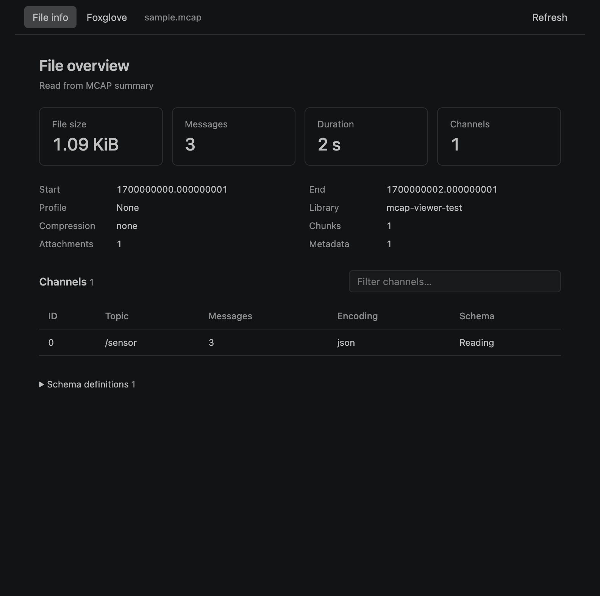

# Foxglove MCAP Explorer

Inspect MCAP files and visualize with Foxglove in VS Code.

Requires desktop VS Code 1.96 or later. Browser-based VS Code is not supported. For SSH or dev containers, install the extension on the remote host.

## Get started

1. Install [**Foxglove MCAP Explorer** from the Visual Studio Marketplace](https://marketplace.visualstudio.com/items?itemName=Foxglove.foxglove-mcap-explorer).
2. Open an `.mcap` file to see file size, duration, message counts, channels, and schemas. No CLI or account is needed for file information.
3. Select **Foxglove** to visualize the recording. Sign in if prompted. Visualization requires internet access and [Foxglove Embed access](https://docs.foxglove.dev/docs/embed).

If the file opens in another editor, choose **Reopen Editor With… → Foxglove MCAP Explorer**.

Your last tab and layout are remembered, and the viewer follows your editor theme. On VS Code 1.96, the embedded Foxglove viewer may stay light when you switch themes; use a recent editor for full theme synchronization.

## Data access and the hosted viewer

File information is read on the extension host and works offline. The **Foxglove** tab loads the hosted viewer from `https://embed.foxglove.dev` and gives it a temporary URL to read the opened recording. The URL serves that recording from a local HTTP endpoint; for SSH or dev containers, VS Code forwards the endpoint. The hosted viewer can read the recording's contents.

If your last tab was **Foxglove**, opening another MCAP automatically restores the hosted viewer and gives it access to that recording. Switching to **File info** leaves the viewer running. Close the MCAP editor to stop its viewer and revoke the recording URL.

This extension is open source under the MIT license. The hosted Foxglove service requires internet access, sign-in, and Foxglove Embed access as described above.

## Layouts and sign-in

Under **Viewer options**:

- **Load shared layouts…** loads organization layouts using a Foxglove API key with layout read access.
- **Import JSON…** loads an exported layout, including personal layouts.
- **Sign-in help → Open sign-in page** lets you enter the viewer’s activation code if its sign-in popup is blocked.

Layout edits are saved locally, not back to your Foxglove account. API keys are stored securely by the editor; use **MCAP: Clear Foxglove API Key** in the Command Palette to remove one.
